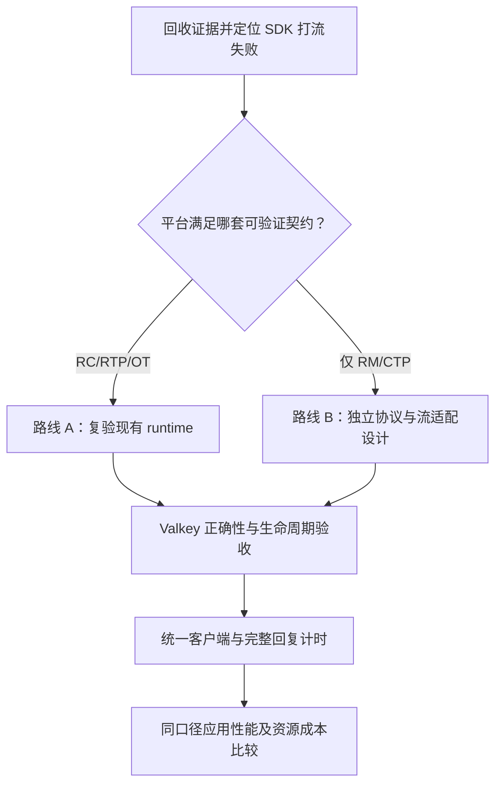

# RDMA 与 URMA/UB SEND 性能对比、生态价值及 UB 适配方案

日期：2026-11-12。测试主机：202/master。范围：同机、单通道、轮询模式的 SEND 组件微基准。
文档状态：第 1～8 节为当前数据分析；第 9～11 节补充路径评估和拟议方案，其中后续适配工作尚未实施或通过现场验收。

**2026-11-13 进展：** [UB 独立测试与带宽补测记录](202-ub-send-follow-up-2026-11-13.zh-CN.md)
新增 UB 延迟 25/25 有效样本及 1024 B 带宽 1/1 成功单点。
新 UB 五轮延迟的 median/p99 观察值均低于历史 RDMA 基线；完整带宽和故障复验仍待完成。
下文保留 11 月 12 日的批次快照及原始判断，其中“UB 延迟只有单轮”等描述不代表最新状态。

## 1. 核心结论

1. **RDMA 已完成计划中的 50 个有效正式样本，各消息大小的延迟和带宽均完成五轮。**
2. **UB 基础组和调整参数后的重试组均中途失败，尚未形成完整五轮基线。**
3. UB 基础组已完成的样本中，RDMA 的 median/p99 延迟更低；2～256 B 的带宽观察值约为 UB 的 **3.67～3.74 倍**。
4. UB 重试组出现更低的小消息延迟，但每个点只有一轮，并在 64 B 带宽测试失败，不能据此确认稳定收益或故障已修复。

上述对比是“RDMA 五轮汇总”与“UB 单轮观察值”的描述性比较，不是两套完整重复实验之间的统计结论。

## 2. 数据来源与比较范围

本文第 1～8 节使用 2026-11-12 版本 `output.md` 中的三份终端汇总：

| 批次 | 现场结果目录 |
| --- | --- |
| RDMA 基础组 | `/root/rdma-send-loopback-UF9iIygF` |
| UB 基础组 | `/root/ub-loopback-1IfR85mO` |
| UB 重试组 | `/root/ub-loopback-y2xZWShq` |

终端汇总文件位于 `/root/send-master-1112-9dadsQ78/`，分别为
`rdma-results.txt`、`ub-results-baseline.txt`、`ub-results-retry.txt`。

- RDMA 测试工具为 `ib_send_lat / ib_send_bw`，使用 verbs/RC。
- UB 测试工具为 `urma_perftest send_lat / send_bw`，使用 RM/CTP；URMA 属于 UMDK 软件栈。
- 测量对象为底层消息收发。Valkey SET/GET 的应用性能应单独报告，SEND 的 Mpps 不等于 Valkey QPS。
- 本文未回收这三批完整归档，尚未独立核验每轮原始日志、设备版本、计时实现和背景负载。
- 不将此前其他目录的 UB 数据混入本轮比较。

## 3. 参数配置与含义

| 参数 | RDMA 基础组 | UB 基础组 | UB 重试组 | 含义 |
| --- | --- | --- | --- | --- |
| 传输路径 | verbs/RC | RM/CTP | RM/CTP | 协议、设备及 provider 实现仍有差异 |
| 拓扑 | loopback | loopback | loopback | 客户端和服务端在同机运行 |
| 完成机制 | poll | poll | poll | 主动轮询完成队列 |
| 带宽通道数 | 1 | 1 | 1 | 一个 QP 或 Jetty，不代表固定占用一个 CPU 核 |
| 带宽 TX depth | 128 | 128 | **64** | 限制发送队列容量和在途请求量 |
| RX depth | 512 | 512 | 512 | 接收队列可预投递的接收请求数量 |
| 带宽 CQ moderation | 100 | 100 | **50** | 完成通知合并粒度；不是每批网络包的数量 |
| inline | 0 | 0 | 0 | 关闭 inline 发送 |
| 计划轮次 | 5 | 5 | 5 | 实际是否完成以有效样本数为准 |
| 有效带宽计时 | 约 15 秒 | 成功点约 15 秒 | 成功点约 15 秒 | 来自汇总中迭代数/消息率反推 |

采集脚本的公共消息大小为 2、64、256、1024、4096 B。延迟测试每轮计划 100000 次，发送深度为 1；
TX128/TX64 和 CQ100/CQ50 的调整应用于带宽测试，不能直接用于解释延迟变化。

CQ moderation 从 100 改成 50，表示完成通知粒度减小；在相同发送请求速率下，完成通知通常更频繁。
当前使用轮询模式，因此不能把这个参数解释为中断次数。两批重试同时改变 TX 和 CQ，尚不能隔离各自影响。

## 4. 完成情况与稳定性

| 批次 | 有效正式样本 | 无效正式样本 | 已尝试 | 计划 | 未执行 | 失败位置 |
| --- | --- | --- | --- | --- | --- | --- |
| RDMA 基础组 | 50 | 0 | 50 | 50 | 0 | 无报告失败 |
| UB 基础组 | 7 | 1 | 8 | 50 | 42 | 1024 B 带宽，第 1 轮 |
| UB 重试组 | 3 | 1 | 4 | 50 | 46 | 64 B 带宽，第 1 轮 |

这里“一份正式样本”指某消息大小、某操作、某轮的一对客户端/服务端试验，预运行不计入。

两批 UB 汇总都只给出 `server exit=255`。退出码 255 本身不足以解释失败根因，
不能直接认定本轮仍然是此前其他批次的 RNR。失败轮的性能数值排除，未执行项不能填零。
“1 个失败样本”也不能解释成固定比例的消息丢包。

## 5. 延迟比较

单位：μs，越低越好。RDMA 每个点为五轮指标的中位数，UB 基础组每个已完成点只有一轮。
最后一列为 UB median 减去 RDMA median。

| 消息大小 B | RDMA median | UB 基础组 median | RDMA p99 | UB 基础组 p99 | median 差值 μs |
| --- | --- | --- | --- | --- | --- |
| 2 | 1.670 | 2.250 | 1.700 | 2.390 | 0.580 |
| 64 | 1.890 | 2.230 | 2.090 | 2.400 | 0.340 |
| 256 | 2.020 | 2.300 | 2.220 | 2.440 | 0.280 |
| 1024 | 2.230 | 2.360 | 2.420 | 2.480 | 0.130 |
| 4096 | 2.590 | — | 2.780 | — | — |

已完成的四种大小中，RDMA 基础组的 median 和 p99 均更低。
median 差值从 2 B 的 0.580 μs 缩小到 1024 B 的 0.130 μs，尚无 UB 4096 B 的本批数据可供比较。

### RDMA 五轮波动与尾延迟

各单元格格式为“跨轮中位数[跨轮最小值,跨轮最大值]”，全部单位为 μs：

| 消息大小 B | median | avg | p99 | p99.9 |
| --- | --- | --- | --- | --- |
| 2 | 1.670[1.660,1.670] | 1.670[1.670,1.680] | 1.700[1.680,1.760] | 3.260[2.680,3.370] |
| 64 | 1.890[1.890,1.900] | 1.930[1.920,1.940] | 2.090[2.070,2.270] | 4.200[3.650,5.010] |
| 256 | 2.020[2.000,2.500] | 2.050[2.040,2.530] | 2.220[2.200,2.720] | 4.300[3.750,4.780] |
| 1024 | 2.230[2.190,2.250] | 2.260[2.230,2.270] | 2.420[2.390,2.620] | 4.250[3.930,5.950] |
| 4096 | 2.590[2.560,2.620] | 2.620[2.590,2.640] | 2.780[2.740,2.820] | 5.320[4.730,6.170] |

例如 `2.020[2.000,2.500]` 表示五轮 median 的中位数为 2.020，五轮 median 的范围为 2.000～2.500，
不是所有消息的最小和最大延迟。256 B 点存在一轮较高的 median，应保留该波动。
各轮 p99/p99.9 的中位数也不等于合并所有原始消息样本后的总体分位数。

UB 的 `[x,x]` 只表示该点目前只有一次有效重复，不能解释为没有波动。
两种工具的计时和样本处理细节尚需原始日志及对应版本源码复核。

## 6. 带宽与消息率比较

### 有效载荷带宽

单位：MiB/s，越高越好。比值为“RDMA 五轮带宽中位数 ÷ UB 基础组单轮带宽”，只描述已观察数值。

| 消息大小 B | RDMA MiB/s | UB 基础组 MiB/s | RDMA/UB 观察比值 |
| --- | --- | --- | --- |
| 2 | 12.97 | 3.47 | 3.74 |
| 64 | 405.99 | 110.68 | 3.67 |
| 256 | 1633.34 | 443.16 | 3.69 |
| 1024 | 5519.25 | 失败，排除 | — |
| 4096 | 11038.40 | 未执行 | — |

前三个大小的观察比值约为 3.67～3.74。由于 UB 缺少重复且发生失败，不将这些比值作为稳定性能提升承诺。

RDMA 的 4096 B 有效载荷吞吐为 **10.78 GiB/s，约 92.60 Gbit/s**。
该结果来自同机设备路径；是否达到设备极限还需结合实际链路速率和设备计数判断。

### 消息率

单位：Mpps，即每秒百万条消息。

| 消息大小 B | RDMA Mpps | UB 基础组 Mpps |
| --- | --- | --- |
| 2 | 6.802 | 1.818 |
| 64 | 6.652 | 1.813 |
| 256 | 6.690 | 1.815 |
| 1024 | 5.652 | — |
| 4096 | 2.826 | — |

RDMA 在 2～256 B 时约为 6.65～6.80 Mpps，UB 基础组约为 1.81～1.82 Mpps。
小消息下消息率几乎不随消息大小变化，字节带宽随消息大小增大而增加，
提示这一阶段可能更受每消息处理速率限制；具体瓶颈仍需 CPU/设备计数确认，不能仅由表格归因。

本文沿用报告器归一化后的 MiB/s；没有用本次完整原始日志再次核验工具最初的 MB/MiB 表头。

## 7. UB 调整参数后的结果

带宽参数从 TX128/CQ100 改为 TX64/CQ50，RX512、单通道和 inline 0 保持一致。

| 指标 | RDMA 基础组：五轮中位数 | UB 基础组：单轮 | UB 重试组：单轮 |
| --- | --- | --- | --- |
| 2 B median 延迟，μs | 1.670 | 2.250 | 1.470 |
| 64 B median 延迟，μs | 1.890 | 2.230 | 1.370 |
| 2 B p99 延迟，μs | 1.700 | 2.390 | 1.620 |
| 64 B p99 延迟，μs | 2.090 | 2.400 | 1.500 |
| 2 B 带宽，MiB/s | 12.97 | 3.47 | 6.15 |
| 2 B 消息率，Mpps | 6.802 | 1.818 | 3.223 |

重试组两个延迟点低于 RDMA 的五轮中位数，但每点只有一次有效试验。
延迟测试仍使用发送深度 1，不能把变快直接归因为带宽测试的 TX/CQ 调整。
两批之间的运行环境、调度和背景负载尚未核实一致。

2 B 带宽从 3.47 增至 6.15 MiB/s，仍低于 RDMA 的 12.97 MiB/s；
随后 64 B 带宽失败。现有证据只能说明这组调整未通过完整五轮验收，
不能单凭失败出现得更早就推断其整体可靠性更差，也不能将它合入原配置补足轮次。

## 8. 当前可报告结论与后续工作

可报告：RDMA 本批组件基线完整；UB 当前存在试验失败及跨批次表现变化；
原始配置的已完成样本中 RDMA 延迟更低、带宽和消息率更高；
UB 重试组显示低延迟的观察值，但尚未验证重复性和持续运行稳定性。

下一步按依赖推进：

1. 回收三批完整归档，核验双端退出码、命令、每轮数据、设备/SDK/驱动/固件及采集工具版本。
2. 先检查 UB 两个失败点的双端原始日志和命令；必要时关联同一时段内核日志，确定失败阶段。
3. 根据证据安排停止条件或接收进度对照，每次控制单个变量，保留所有失败。
4. 问题定位后，固定环境和参数补齐 UB 各配置五轮；两后端按配对轮次复测，再讨论稳定差异。
5. 基础容量与稳定性完成后补 CPU/RSS、必要的 irq/softirq，随后扩展多通道、双机或 Valkey 应用测试。

当前结果尚不能量化 CPU 节省、物理链路峰值或 Valkey SET/GET 加速比例。

## 9. 各路径当前的优势、局限与定位

### 9.1 当前证据支持的优劣

| 维度 | RDMA / verbs RC | 原生 URMA / UB RM/CTP | 当前判断 |
| --- | --- | --- | --- |
| 基线完整性 | 50/50 有效正式样本，各配置五轮 | 基础组 7 个、重试组 3 个有效样本，均中途失败 | 本批 RDMA 的重复证据更充分；不外推为所有平台或生产稳定性结论 |
| 原始配置小消息延迟 | 2～1024 B median 为 1.67～2.23 μs | 对应点为 2.23～2.36 μs，均只有单轮 | 原始配置中 RDMA median/p99 更低 |
| 原始配置小消息吞吐 | 2～256 B 为 6.65～6.80 Mpps | 为 1.81～1.82 Mpps | RDMA 成功样本的带宽观察值为 UB 的约 3.67～3.74 倍，仍有重复次数不对等的限制 |
| 低延迟潜力 | 五轮分布及波动可审阅 | 重试组 2/64 B median 为 1.47/1.37 μs，低于 RDMA 对应中位数 | UB 存在值得复验的低延迟观察值，尚未证明可重复或可转化为应用收益 |
| 持续打流 | 本批未报告用例失败 | 两种参数组合均出现退出 255 | UB 当前的主要缺项是失败定位和完整重复验证 |
| CPU / 内存成本 | 本批没有稳态 CPU/RSS | 本批没有稳态 CPU/RSS | 不能比较 CPU 节省、每操作成本或内存收益 |
| Valkey 应用接入 | 仓库已有 RDMA 后端及 libvalkey 支持 | 仓库已有实验性服务端适配基础，但缺少等价原生 URMA 性能客户端 | RDMA 更接近现有应用测试流程；UB 仍需客户端、契约和设备验收 |

RDMA 的工程优势还包括可复用 libibverbs、librdmacm 及多 provider 的用户态基础设施；
这些是现有生态资产，不等于本次测出了所有硬件上的兼容性或性能。
参见 [rdma-core 官方说明](https://github.com/linux-rdma/rdma-core/blob/master/README.md)。
Valkey 上游仍将 RDMA 标为实验功能，因此本批五轮通过不构成生产可用性声明。
参见 [Valkey 官方 README](https://github.com/valkey-io/valkey/blob/unstable/README.md#running-valkey-with-rdma)。

### 9.2 当前的工程取舍

- 保留 RDMA 作为本阶段可重复的比较基线；是否选作业务部署路径，还需应用层、故障和运维验证。
- 保留原生 URMA/UB 为独立实验路径，优先解决持续打流失败和现有适配契约不匹配，再比较应用收益。
- 两批 UB 的带宽参数不同，延迟变化也未隔离运行环境影响，不据此选择“TX64/CQ50 已最优”。
- 暂不替换默认传输，不把低延迟单点、单向有效载荷吞吐或 SDK 消息率作为业务加速承诺。

## 10. 生态价值：已有资产与待验证收益

### 10.1 这项工作的直接价值

**第一，形成可复用的设备到应用验证链。** 本仓库已经把成对命令、参数、退出码、
原始日志和终端汇总串起来。RDMA 的完整基线与 UB 的失败样本共同提供排查依据，
后续可区分平台能力、SDK 行为、传输适配和 Valkey 应用瓶颈。

**第二，为 Valkey 保留独立传输扩展入口。** 通过现有 ConnectionType 和客户端函数表接入，
上层继续使用 RESP、命令执行和数据结构；传输变化不必扩散到每个业务命令。
但客户端仍需要对应传输实现，RESP 语义兼容不代表现有 TCP 客户端能直接连接原生 URMA。

**第三，提供通用数据服务的验证样例。** 若功能和性能准入通过，Valkey 可为缓存/KV 类服务
提供原生 UB 适配参考，包括流控、分段、关闭、异步进度及资源回收。该价值属于工程复用和
生态验证，不是本次已经测得的端到端性能收益。

UMDK 官方将 URMA 定位为提供单边、双边及原子操作的通信基础，并介绍了 Socket 兼容组件。
这说明原生 API 和兼容接口可作为不同评估路线；具体组件名称、安装情况和能力须按现场版本核验。
参见 [UMDK 官方介绍](https://github.com/openeuler-mirror/umdk/blob/master/README.md)。

### 10.2 三种生态接入路线的取舍

| 路线 | 可复用资产 | 主要投入与限制 | 本项目定位 |
| --- | --- | --- | --- |
| 现有 verbs/RDMA | rdma-core、perftest、Valkey RDMA 后端和客户端 | 仍需设备配置、应用功能及故障验证；上游为实验功能 | 当前基线与应用对照路径 |
| Socket/verbs 兼容 UB 路径 | 若配套平台支持，可评估复用既有应用接口 | 必须先确认实际提供的组件、兼容范围和数据路径；不能由原生 URMA 成功推断兼容层可用 | 可选迁移评估，当前未部署验证；RoUB 能力同样待平台确认 |
| 原生 URMA/UB | 已有 protocol/session/runtime/ConnectionType 基础 | 需要匹配设备语义、实现客户端、验证生命周期和资源成本 | 本项目的实验适配主线，尚未完成应用准入 |

兼容路径与原生路径若都要比较，分别命名、固定 API/设备/版本并测试。
不能把兼容层结果标为原生 URMA，也不能把不同硬件的差异全部归因于 API。

### 10.3 生态价值需要怎样落地证明

| 目标 | 需要交付的证据 | 当前情况 |
| --- | --- | --- |
| 应用可接入 | 服务端和客户端可构建、连接、认证、完整读写 | 有实验源码和功能探针，真实原生应用验收仍待完成 |
| 迁移成本可控制 | 配置差异、客户端改动、协议版本和已支持功能清单 | 需随适配阶段补齐，不以“零改造”概括原生路径 |
| 资源效率有收益 | 同负载/同 CPU 预算下的 QPS、p99、双端 CPU 秒/操作及 RSS | 当前组件数据不含该证据 |
| 可运维 | 可诊断错误、资源上限、超时、关闭、版本兼容矩阵和回退说明 | 采集已有基础，平台/应用生命周期验收尚未完成 |

URMA 提供远程内存语义，也不自动意味着当前 Valkey 适配具备应用零拷贝或远端 Value 池化能力。
当前 [session 实现](../../src/urma_session.c)仍有显式数据复制；此类优化需另行测量和设计。

## 11. 后续 UB 适配方案

以下是本报告提出的后续路线和验收建议，不表示已经修改 transport 模式或实现客户端。
已有 [应用压测改进方案](rdma-urma-performance-comparison-design.zh-CN.md)保留为背景设计，
本节根据本轮新增数据明确当前优先级。

### 11.1 先核对已有实现与设备路径的差距

| 代码落点 | 已有能力/约束 | 与本次 RM/CTP 结果的关系 |
| --- | --- | --- |
| [urma_transport.c](../../src/urma_transport.c) | 初始化检查 RC、RTP、OT；端点描述和导入/绑定同样固定该组合 | RM/CTP perftest 成功不能直接满足现有 runtime 契约 |
| [urma_protocol.h](../../src/urma_protocol.h)、[urma_session.c](../../src/urma_session.c) | 有帧、字节序列、代次、信用和关闭状态；按有序字节流处理 | 若换模式，需要重新验证可靠性、顺序、分段和控制进度，不能只改 trans_mode |
| [urma.c](../../src/urma.c) | 已有入站 ConnectionType；限制单 I/O 线程，持久化/fork、复制和 Cluster 组合未准入；出站连接未实现 | 首版继续在隔离的单实例范围验证，不能直接接管所有 Valkey 网络路径 |
| [client_probe.c](../../tests/urma/client_probe.c)、[probe_io.h](../../tests/urma/probe_io.h) | 功能探针；无进度时可 sleep 1 ms | 保留为正确性工具，不用其等待循环发布微秒级应用性能 |
| [valkey-benchmark.c](../../src/valkey-benchmark.c)、[valkeyContextFuncs](../../deps/libvalkey/include/valkey/valkey.h) | 已有 benchmark 和客户端传输函数表；当前没有原生 --urma 性能入口 | 可作为统一发生器的接入点，仍需实现非阻塞进度、背压和生命周期 |

### 11.2 传输模式选择：两条候选路线

**路线 A：平台满足现有 RC/RTP/OT 契约。**

核对设备能力、匹配的 SDK/provider/驱动/固件和非共享 TP 的导入绑定行为；
先用与应用相同接口和参数的独立探针验证，再推进现有 runtime。
这条路线对当前协议和服务端代码的改动相对较小，但目前尚无其真实应用收发验收证据。
不能因为 RM/CTP 能打流就跳过 RC/RTP/OT 检查，也不能仅凭资源创建成功认定设备顺序满足要求。

**路线 B：平台主要支持经验证的 RM/CTP，需要独立适配。**

先取得配套版本对交付可靠性、消息顺序、完成与 DMA 缓冲生命周期、共享 JFR 和关闭行为的明确保证。
在独立实验分支中设计并验证以下内容：

1. 端点和握手显式协商模式/TP/顺序能力及协议版本，双方不匹配时拒绝连接；当前端点格式硬编码的字段须随之调整。
2. 若不能保证应用所需顺序，另立有界的序列重排和缺口处理设计；无法给出可验证的可靠有序流契约时停止该路线。
3. 将消息长度上限与帧头一起纳入协商。当前协议头为 **40 B**；若平台 CTP SEND 上限确认为 **4096 B**，
   DATA 有效载荷最多为 **4056 B**，还需扣除后续新增的任何元数据。
   4 KiB Value 加 RESP 编码会跨帧，不能把 perftest 的 4096 B 消息等同于 4096 B 应用 Value 的单帧能力。
4. 接收补充、应用消费和信用归还分开追踪；只有接收资源重新投递成功后才归还相应信用。
   控制帧保留有界额度，慢客户端或 DATA 满队列时仍能推进 CREDIT/CLOSE。
5. 共享接收资源下验证会话分发、跨连接隔离、额度统计和迟到完成归属；停止提交后确认 DMA 终止，才能释放注册缓冲。

路线 B 是新适配工作，不是给当前 RC 实现增加 --ctp 开关。默认门禁保持有效，不能通过删除 OT 检查来宣称适配完成。

### 11.3 分阶段实施与准入条件

| 阶段 | 主要工作 | 交付物与进入下一阶段的条件 |
| --- | --- | --- |
| P0：证据对齐 | 回收三批归档，核对版本、原始命令、退出码、环境和失败阶段 | 形成可复现配置与错误定位记录；本次退出 255 的具体含义得到双端日志支持 |
| P1：SDK 稳定性 | 固定次数与 duration 分组，定位运行中接收进度及结束同步；按单变量比较参数 | 选定候选模式的同机基础组各配置五轮有效重复，并保留失败；不同模式分别准入，补测真实双机路径 |
| P2：应用传输契约 | 按路线 A 或 B 完成对应资源、顺序、分段、控制和关闭验证 | 明确支持组合；真实收发、二进制内容、顺序、背压和资源回收通过；软件 mock 不能代替硬件验收 |
| P3：Valkey 功能 | 使用隔离实例验证 AUTH/ACL、PING、SET/GET/DEL、二进制和跨帧值；慢读、断连、重连及多连接额度 | 正确性、错误传播和生命周期记录完整；不提前放开持久化、复制或 Cluster 门禁 |
| P4：等价客户端与计时 | 复用客户端函数表/benchmark 核心，补原生 URMA adapter、完整回复计时及相位记录 | 部分读写、AGAIN/EOF、背压、超时和计时语义经软件及真实设备验证；形成可运行客户端及构建说明 |
| P5：应用收益评估 | TCP/RDMA/URMA 按同一公共代码和负载重测，采集双端资源成本 | 每配置至少五轮；命中/内容校验、QPS、完整回复 p99、CPU/RSS、错误和配置齐备，才能发布应用差异 |
| P6：功能与部署扩展 | 按实际需求验证认证引导、数据保护、多 I/O 线程、持久化/fork、复制及 Cluster | 每项独立准入；在未通过前维持明确的实验范围和限制 |

阶段中的纯软件开发可以提前推进，但现场准入条件保持依赖顺序，不能用开发完成代替设备验收。
路线 A 使用 RC/RTP/OT 的匹配验证记录；路线 B 使用 RM/CTP 的匹配记录。
两者不能互相代验，也不要求用无关模式的成功结果来证明另一条路线可用。
2026-11-13 更新：RM/CTP 延迟五轮已补齐，带宽仅新增 1024 B 单点通过，P1 整体尚未完成。

P1 参数对照建议先用 **TX128/CQ100 → TX128/CQ50 → TX64/CQ50**，每一步只改变一个参数；
固定次数/持续时间、绑核、信用和重试策略另分实验，避免同时调整后无法归因。
当前基础容量不以单次最快结果作为默认值，失败样本始终保留。

### 11.4 应用层适配与测量口径

首组应用测试固定为单客户端工作线程、服务端单 I/O 线程、32 个连接、Pipeline 1、
Value 256 B、10000 个 Key；独立 SET 和预填充后命中 GET，固定随机种子和数据校验策略。
建议 5 秒预热、30 秒正式测量、至少五轮。这是新的应用组，不与当前 SDK 约 15 秒窗口混合统计。

统一发生器应遵守以下约束：

- TCP/RDMA/URMA 共享请求生成、RESP 解析、校验、相位和直方图；URMA adapter 只承担连接及字节流进度。
- 首版每进程一份 runtime、一个工作线程，通过同一循环公平推进连接，不跨 fork 继承已初始化的设备资源。
- 当前服务端还有实验性的 1 ms 定时轮询入口；后续需验证事件通知或有界轮询如何接入 ae，测清延迟与 CPU 权衡，不能用 SDK 微秒级数字推断应用时延。
- 请求提交后到对应完整 RESP 回复接收、解析、校验完成为一次延迟；每请求独立记时，不将 SDK 本地发送完成视为命令成功。
- 当前 benchmark 在首次 read event 记录延迟，需统一修正参与路径后重测；不能把旧 RDMA 延迟与新 URMA 完整回复延迟直接拼接。
- 预热结束排空旧请求再清零；正式窗口结束停止发新请求并限时排空，记录窗口后完成和超时，保留末尾慢请求的可见性。
- 分别报告双方 CPU 秒/成功操作、RSS 和必要的 irq/softirq；比较同 CPU 预算或共同可承受目标 RPS 下的 QPS/p99。

性能优化在正确性与计时一致后进行：优先定位 progress/poll、内存复制、批量提交和完成处理成本，
再逐项评估 inline、多通道、队列深度或单边操作。READ/WRITE 与远端 Value 存储需要新的协议和故障语义验收。

### 11.5 试用、回退及停止条件

- 当前代码的引导需要显式允许不安全 bootstrap，认证引导和业务数据保护尚未完整实现；
  新部署阶段需独立验证它们，不能把 Valkey AUTH、UB token 或将来的 TLS 引导视为整个数据面的机密性保证。
- TCP/RDMA 与原生 URMA 作为显式选择的监听和客户端路径保留。失败时清晰报错；
  已提交且结果不确定的命令不自动跨传输重放，避免重复执行 INCR 等有副作用操作。
- 若平台无法提供可验证的可靠有序流契约，或 SDK 错误/资源回收问题未解决，暂停应用性能准入并继续定位。
- 若同口径应用测试未体现吞吐、尾延迟或资源成本价值，则保留实验入口和数据，继续使用已验证路径；
  不为适配而放宽正确性门禁或默认替换已有后端。

## 12. 追溯信息与参考

- 本地来源：`D:\valkey\output.md` 的 2026-11-12 版本；该工作区文件随后已被新批次更新，历史指纹保留如下。
- 来源文件 SHA256：`1b6f2526574f177a2a74389cc35d582e93280beff417ce57c7f62479cf404af9`。
- 原始材料为终端汇总文本；本报告中的比例与单位换算根据汇总数值计算。
- 采集与汇总实现：[RDMA 采集脚本](../../utils/rdma_send_loopback_perftest.sh)、
  [UB 采集脚本](../../utils/ub_loopback_perftest.sh)、
  [终端报告器](../../utils/send_perftest_report.py)。
- 本节之外的生态资料于 2026-11-12 核对；官方主线说明用于解释接口和生态定位，不能替代现场安装版本验收。
- 适配设计依据：[本仓库原生 URMA 架构](../../tasks/urma-architecture.md)、
  [性能评估设计](rdma-urma-performance-comparison-design.zh-CN.md)及第 11.1 节所列实现。
