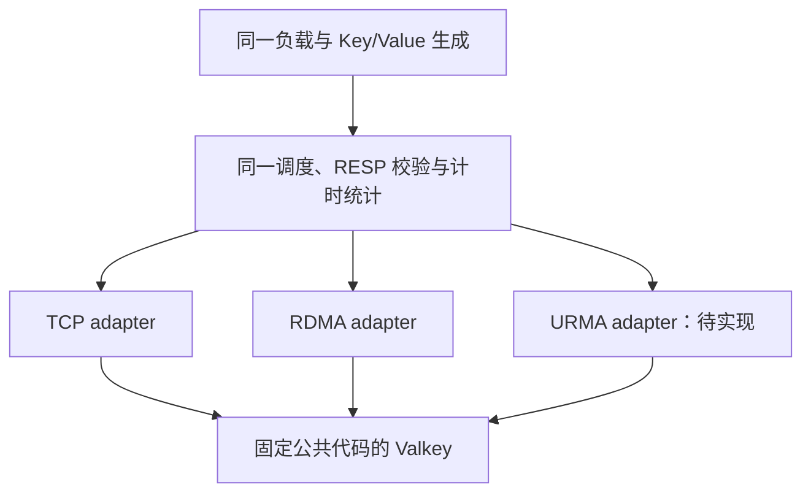

# RDMA / 原生 URMA 性能评估改进方案

日期：2026-11-11。状态：方案提案，统一 URMA 压测客户端及改进采集接口尚未实现。
本方案不新增性能结论；已运行项目以原始归档及
[现场阻塞摘要](202-ub-platform-blockers.zh-CN.md)为准。

## 当前可行路线

UB 是互联硬件/体系，URMA 是访问 API，二者不能直接作为两个平行的压测对象。
结合当前证据，路线如下：

| 比较路径 | 当前可行性 | 能回答的问题 |
| --- | --- | --- |
| TCP vs RoCE/RDMA | 现有 Valkey 和 benchmark 已有两种能力，可先开展；采集脚本需补 TCP 模式 | 当前 RoCE 主机对上的应用路径成本 |
| RoCE/RDMA vs 原生 URMA/UB | 目标路线；URMA 仍未通过建链/功能准入 | 两套实际部署路径的端到端表现，需保留硬件/拓扑差异 |
| 同一 UB 硬件上的 RoUB vs 原生 URMA | 只有确认部署了可用 RoUB 且功能通过后才可安排，目前未确认 | 尽量控制硬件差异，比较兼容 API 与原生 API 的软件成本 |

近期推荐先审阅 202 同机 RDMA 归档，并准备 TCP/RDMA 对照；UB 平台排查和统一
发生器设计可以并行推进。不要将未验证的 RoUB 当作当前可用替代路线。
现有 `rdma_baseline.py` 只支持 RDMA 实例及其配置检查，没有 TCP backend 参数；
“benchmark 已支持 TCP”不等于现有采集脚本已能一键测 TCP。

同机与双机分组报告。202 同机结果用于检查软件路径和采集流程，不能替代主机间
网络性能；跨不同 NIC、速率、CPU/NUMA、固件的结果，也不能只归因于传输 API。

## 三层验收分别进行

| 层次 | 验收内容 | 输出 |
| --- | --- | --- |
| SDK/设备 | 创建、导入、绑定、真实收发、顺序及销毁 | 原生设备路径是否可用、具体失败阶段 |
| Valkey 功能 | AUTH/PING、SET/GET/DEL、二进制值及跨帧分段、credit/CLOSE、异常清理 | RESP 命令和数据语义正确性 |
| Valkey 性能 | 统一负载、完整回复计时、重复实验、CPU/内存/错误 | 可比较的 QPS 和延迟/资源成本 |

只有前一层具备证据才进入后一层。`order-probe` 的成功只证明资源创建/删除，
`urma_perftest` 的数字属于 SDK 微基准；两者均不能替代 Valkey 性能结果。

当前 UB 准入重点是共享 TP compat 拒绝与 TP 查询超时。独立 SDK 复验应匹配 Valkey
实际使用的 RC/RTP/OT 和非共享 TP 描述，不让 perftest 的其他配置替代应用契约。
`rc_order=0` 的兼容策略须由配套版本/平台保证和真实顺序验证支持，不以本地创建
成功为依据直接绕过门禁。

## 统一发生器：优先复用现有 benchmark 核心

推荐在实验分支扩展现有 `valkey-benchmark` 的客户端传输接缝，让 TCP、RDMA、URMA
共用请求生成、Key 序列、RESP 编解码、并发/Pipeline、计时和直方图。
已有 `valkeyContextFuncs` 提供连接和读写函数表，可作为客户端 adapter 设计入口；
URMA 仍需实现非阻塞进度、背压、事件循环接线和完整生命周期，不是增加一个 CLI 标志即可。

URMA adapter 应封装 bootstrap、分段、credit、Progress 和清理。共享核心只感知
部分读写、暂不可用、终止错误、EOF 和关闭完成，不解析 SDK 私有状态。
不将服务端配置/全局状态直接带入客户端库；依赖和构建设置需单独验证。

不把当前 `client-probe` 改成循环压测：其 `streamIO` 在无进度时会 `usleep(1000)`，
这会将功能探针的等待策略带入性能结果。它继续承担正确性验收。
以上 adapter 和相应 CLI 均待实现；当前不存在可直接运行的 `valkey-benchmark --urma`。

第一版统一为每个客户端进程一个工作线程、一份 URMA runtime，多条连接由同一
调度循环公平推进，服务端 I/O 线程固定为 1。不得直接将现有多线程参数照搬给
当前单 runtime/owner-thread 契约。以后扩展可先用独立启动的工作进程，每个进程
独立初始化 runtime；不从已初始化 URMA 的进程 fork 后继承设备资源。

## 优先修正测量口径

当前 `valkey-benchmark` 在首次 read event 计算延迟，并将该值用于随后解析的回复；
见 [readHandler](../../src/valkey-benchmark.c)。独立 URMA 发生器如果测到完整 GET
回复结束，两者定义就不同。新一轮统一核心需采用同一明确口径：

- 请求进入发送队列时记录一次 `t_submit`，包括后续部分写入和背压等待。
- 对应 RESP 回复完整接收、解析并按统一策略校验后记录 `t_complete`。
- 延迟为两者之差。每个请求单独记时，Pipeline 内各请求各记一笔，不复用首个
  read event 的时间，也不将 SDK 本地发送完成视作服务端命令成功。
- 三条路径使用同一单调时钟、单位、直方图精度和校验策略；溢出/丢失样本单独计数。
- 每个工作进程保留直方图，汇总桶计数后再求总体分位数。不能平均各进程的 p99；
  多轮仍保留每轮 p99，并明确中位数是“各轮分位数的中位数”。

[HdrHistogram 官方说明](https://github.com/HdrHistogram/HdrHistogram)支持分开记录再
聚合直方图，也说明了有预期间隔时的延迟缺失修正。后续开放负载必须记录实际计划
发送时间、排队和漏发；不能将闭环结果当作生产开放负载尾延迟，也不凭空合成缺失样本。

旧归档保留为旧发生器口径。采用新计时核心后，应为参与比较的各 backend 全部重测，
不把旧 RDMA 的延迟与新 URMA 的延迟拼接为同口径结果。

## 预热、结束和 CPU 窗口

第一组继续采用 5 秒预热、30 秒正式发压、每操作/路径至少 5 轮。改进点为：

1. 连接和认证在稳态测量前完成；预热结束后停止发新请求并排空旧请求，再清空
   计数/直方图，保持连接，开始正式窗口，避免预热样本进入统计。
2. 30 秒到达后停止新请求，限时排空测量期请求；记录测量 cohort、窗口内完成数、
   窗口后完成数、drain 时长及未完成数。窗口 QPS 用窗口内成功完成数除以 30 秒。
   cohort 延迟包含窗口后才完成的请求，避免把窗口末尾慢请求直接丢掉；超时计为错误。
3. 每轮记录 warmup/measurement/drain 的实际相位标记。本地采集使用单调时间和
   CPU 累计计数；两端以时钟探测/握手对齐并报告边界误差，不再只依赖启动时间加 5 秒。
4. 客户端和服务端分别报告 CPU 秒/成功操作、CPU 百分比（100% 为一逻辑核）、RSS。
   一份总 CPU 百分比不能替代双端成本；发生错误的轮次不进入有效基线汇总。

进程 CPU 之外保留主机/选定 CPU 的 user/system/irq/softirq 计数，避免将中断或
软中断成本漏计为“CPU 节省”；有其他 GPU/CPU 任务时标注背景负载，主机总量不能
直接归到被测进程。应用有效载荷吞吐按成功字节数计算，设备 wire/控制帧计数按
各自已确认的单位解释，二者分别报告。

记录事件/轮询及等待策略，比较相同 CPU 预算下的 QPS、p99 和 CPU 成本。
URMA 忙轮询与 RDMA 事件驱动的差异应列在配置中，并另做策略分组；不能用低 CPU
的固定 sleep 功能循环与持续轮询发生器作未说明的比较。

## 负载和公平性

先做可解释的小矩阵，再扩展：

| 阶段 | Value | 总连接 | Pipeline | 操作 |
| --- | --- | --- | --- | --- |
| 首组 | 256 B | 32 | 1 | 独立 SET、100% 命中 GET |
| 并发与排队 | 256 B | 1、32、128 | 1、16 | 同上 |
| 尺寸扩展 | 64 B、1 KiB、4 KiB、64 KiB | 先固定 32 | 先固定 1 | 同上 |

固定 10000 Key、种子、Value 生成规则和校验策略，预填充并检查每个值的长度/内容。
SET 以成功回复计数，GET 以完整且符合预期的值计数，miss/错误/超时均独立记录。
值生成和检查成本必须在两条路径一致；出现客户端瓶颈时先测清发生器能力。
初版不要把 `-t set,get` 当作混合比例；真实混合读写另用共享的调度模型。

同一主机对、公共代码提交、优化/allocator、I/O 线程、持久化和测试 ACL 保持一致。
AUTH/连接建立与稳态 QPS 分开统计，凭据不进入归档。选择相同的空闲窗口，记录
CPU/NUMA、网卡速率、内核/固件、后台任务和权限；普通用户与 root 结果分组。
若两块设备位于不同 NUMA 节点，先固定同一套 CPU 放置并标注远端访问，再将
各自最优本地放置作为另一组；不将两种放置策略混进同一比较。新固定放置组与旧
默认调度组也分开归档。

配对轮次采用 A/B、B/A 交替，并保存每轮结果。吞吐上限之外，再用相同目标 RPS
比较 p99 和 CPU；目标速率需在两条路径都能稳定承受的范围，饱和点另报。
首版闭环用于基础容量，开放负载/服务端排队及达成约定 p99 上限的最大 QPS 放到后续组。

## 可立即做与待实现工作

| 顺序 | 工作 | 验收条件/当前状态 |
| --- | --- | --- |
| 1 | 回收并审阅两份 202 RDMA 同机归档 | 10 个样本、CPU/设备/版本记录齐备；归档尚待回收 |
| 2 | 为现有采集器补 TCP 模式，先做 TCP/RDMA 对照 | 相同负载、实例配置检查与归档规则；待实现，benchmark 本身已有能力 |
| 3 | 平台建链定位、匹配应用参数的 SDK 验证 | 不共享 TP 的 RC/RTP/OT 导入、绑定及收发通过；当前未通过 |
| 4 | 实验分支补统一客户端 URMA adapter 和计时核心 | 软件测试验证部分 I/O、背压、EOF、计时/相位；真实 SDK 链接及关闭验收；待实现 |
| 5 | 原生 URMA Valkey 正确性和双机性能 | 功能门禁、完整数据校验及资源清理通过后，重测各参与路径；待硬件准入 |
| 6 | 扩展并发、尺寸及开放负载 | 每配置重复、错误/客户端瓶颈检查和配对汇总；待首组有效 |

工作 2 和 4 的软件部分可以在平台修复期间推进，但软件 mock 不能勾选硬件收发验收。
不预先发布 URMA 提升百分比，不把“可设计/可开发”描述为“当前已能运行”。
